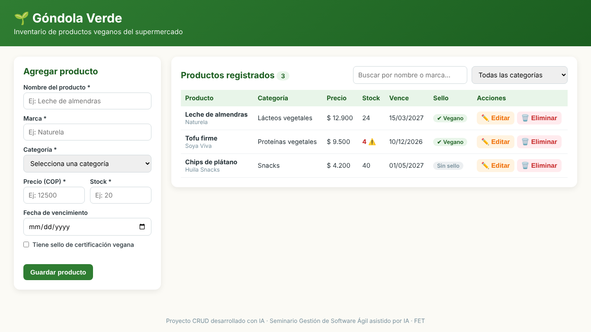
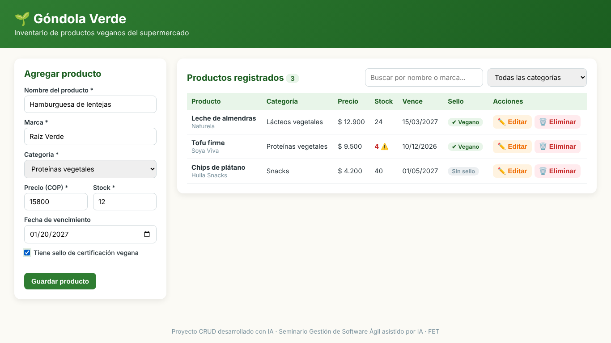
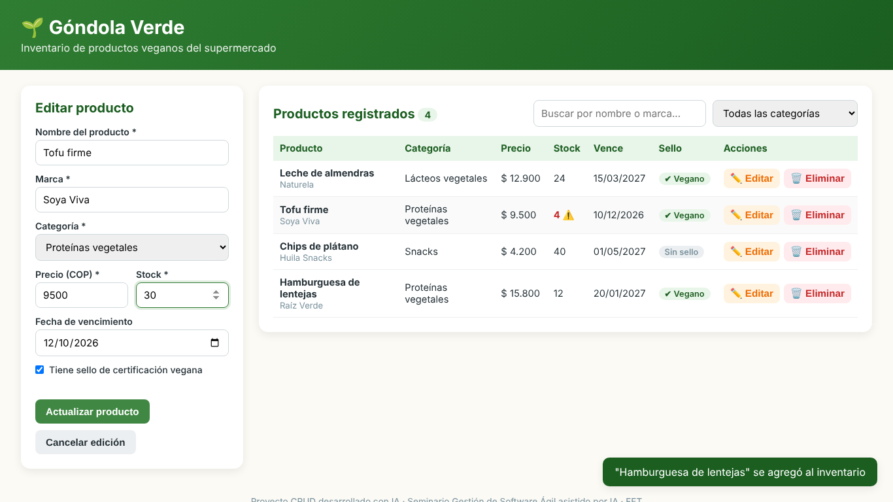
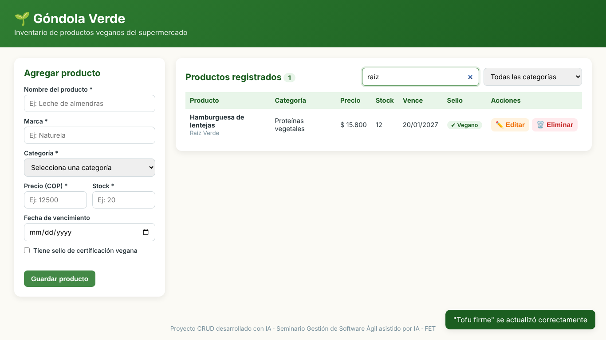
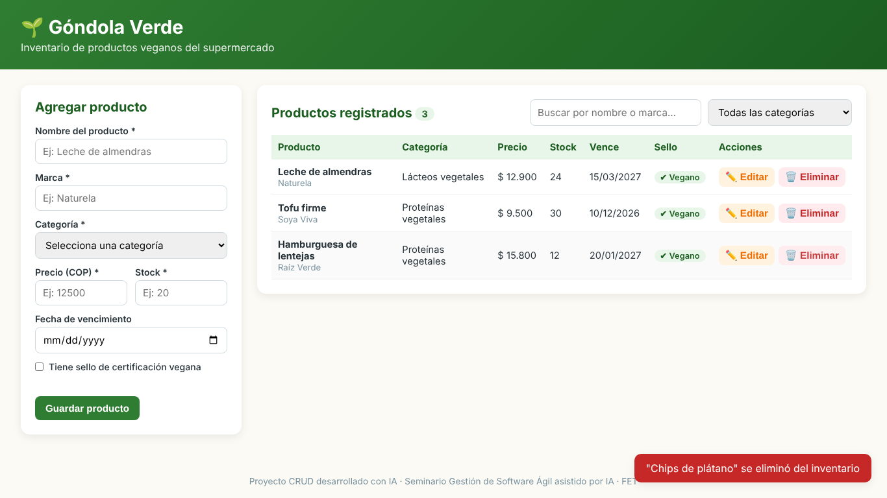

# 🌱 Góndola Verde

**Aplicación web CRUD para gestionar el inventario de productos veganos de un supermercado.**

Trabajo práctico del seminario *Gestión de Software Ágil asistido por Inteligencia Artificial* – Fundación Escuela Tecnológica de Neiva (FET).

## Descripción

Góndola Verde permite que el personal de un supermercado administre los productos veganos que tiene en la góndola: registrar productos nuevos, consultarlos con buscador y filtro por categoría, editar su precio o stock y eliminar los que ya no se venden. La app avisa cuando un producto tiene stock bajo (5 unidades o menos) o está vencido, y muestra si el producto tiene sello de certificación vegana.

Todo el desarrollo se hizo guiado por prompts de inteligencia artificial y después se revisó, se probó y se ajustó a mano.

## Funciones del CRUD

| Acción | Qué hace en la app |
|---|---|
| **Create** (crear) | El formulario de la izquierda registra un producto nuevo con nombre, marca, categoría, precio, stock, fecha de vencimiento y sello vegano. |
| **Read** (leer) | La tabla de la derecha muestra todos los productos, con buscador por nombre o marca y filtro por categoría. |
| **Update** (actualizar) | El botón ✏️ **Editar** pasa los datos al formulario; al guardar se actualiza el producto. |
| **Delete** (eliminar) | El botón 🗑️ **Eliminar** borra el producto después de pedir confirmación. |

Los datos se guardan en el navegador con **localStorage**, así que no se pierden al recargar la página.

## Tecnologías utilizadas

- **HTML5**: estructura de la página y formulario.
- **CSS3**: estilos, diseño con Grid y Flexbox, diseño adaptable a celular.
- **JavaScript** (sin librerías): lógica del CRUD, validaciones y búsqueda.
- **localStorage**: almacenamiento de los datos en el navegador.
- **Visual Studio Code** con la extensión **Live Server**: editor y servidor local.
- **Claude** (Anthropic): asistente de IA usado para generar y mejorar el código.

## Estructura del proyecto

```
gondola-verde/
├── index.html        # Estructura de la página
├── css/
│   └── styles.css    # Estilos
├── js/
│   └── app.js        # Lógica del CRUD
├── capturas/         # Capturas de pantalla para este README
└── README.md
```

## Cómo ejecutar el proyecto

1. Clona o descarga el repositorio:
   ```bash
   git clone https://github.com/USUARIO/gondola-verde.git
   ```
2. Abre la carpeta en **Visual Studio Code**.
3. Haz clic derecho sobre `index.html` y elige **Open with Live Server** (o abre `index.html` con doble clic en el navegador).
4. ¡Listo! La primera vez aparecen 3 productos de ejemplo.

> No necesita instalar nada más: no usa servidor ni base de datos.

## Capturas de pantalla

**Lista de productos (Read)**


**Agregar un producto (Create)**


**Editar un producto (Update)**


**Búsqueda en tiempo real**


**Después de eliminar un producto (Delete)**


## Prompts utilizados

Estos son los prompts principales que se usaron en Claude, en orden, con lo que se pidió y para qué.

### Prompt 1 – Estructura del proyecto (HTML)
> Quiero hacer una aplicación web CRUD llamada "Góndola Verde" para gestionar el inventario de productos veganos de un supermercado. Usa solo HTML, CSS y JavaScript, sin frameworks, y guarda los datos en localStorage. Primero dame el archivo index.html con un encabezado, un formulario a la izquierda (nombre, marca, categoría, precio, stock, fecha de vencimiento y un check de sello vegano) y una tabla a la derecha para listar los productos con botones de editar y eliminar. Enlaza css/styles.css y js/app.js.

**Para qué:** obtener la estructura base de la página y definir los campos de cada producto.

### Prompt 2 – Lógica del CRUD (JavaScript)
> Ahora crea js/app.js con las cuatro funciones del CRUD usando localStorage: crearProducto, mostrarProductos, actualizarProducto (cargando los datos en el mismo formulario para editarlos) y eliminarProducto con confirmación. Agrega 3 productos veganos de ejemplo para la primera vez que se abra la app. Comenta cada parte del código en español.

**Para qué:** generar la lógica que hace funcionar las cuatro acciones del CRUD y que los datos queden guardados.

### Prompt 3 – Diseño (CSS)
> Crea css/styles.css con un diseño limpio y moderno en tonos verdes, que transmita algo natural y vegano. Usa tarjetas con sombras suaves, botones de colores distintos para editar y eliminar, y que en celular el formulario y la tabla queden uno debajo del otro.

**Para qué:** darle una identidad visual relacionada con el veganismo y hacer la app adaptable a celular.

### Prompt 4 – Mejoras y validaciones
> Mejora la aplicación: agrega validaciones para que no se puedan guardar productos sin nombre, marca o categoría, ni con precio o stock negativos; muestra el error debajo del formulario; agrega un buscador por nombre o marca y un filtro por categoría; marca en rojo el stock bajo (5 o menos) y los productos vencidos; y muestra un aviso flotante cuando se crea, edita o elimina un producto.

**Para qué:** evitar datos incorrectos y hacer la app más útil para un supermercado real.

### Prompt 5 – Refactorización
> Revisa todo el código de app.js y refactorízalo: separa la parte de datos (localStorage) de la parte visual, evita código repetido, usa nombres claros en español, protege la tabla para que el texto escrito por el usuario no se interprete como HTML y deja comentarios útiles en cada sección.

**Para qué:** dejar el código más ordenado, seguro y fácil de explicar.

### Prompt 6 – Corrección de errores encontrados al probar
> Al probar encontré dos problemas: el campo de stock se sale de la tarjeta del formulario y, cuando le doy a editar después de un error, el mensaje de error sigue apareciendo. Corrígelos.

**Para qué:** corregir fallas que se detectaron al probar la app manualmente.

## Ajustes propios (criterio personal)

La IA ayudó a generar el código, pero se revisó y se ajustó con criterio propio:

- Se eligió el tema (productos veganos de supermercado), los campos y las categorías pensando en un caso real.
- Se probaron una por una las cuatro acciones del CRUD y se corrigieron los errores de diseño encontrados (Prompt 6).
- Se usaron marcas y productos de ejemplo cercanos al contexto local (por ejemplo, *Huila Snacks*).
- Se revisó cada función para poder explicarla con palabras propias en el video.

## Autora

**Zarhy Liceth Peña** – Fundación Escuela Tecnológica de Neiva (FET)

## Video explicativo

📹 [Ver el video en YouTube](ENLACE_DEL_VIDEO)
